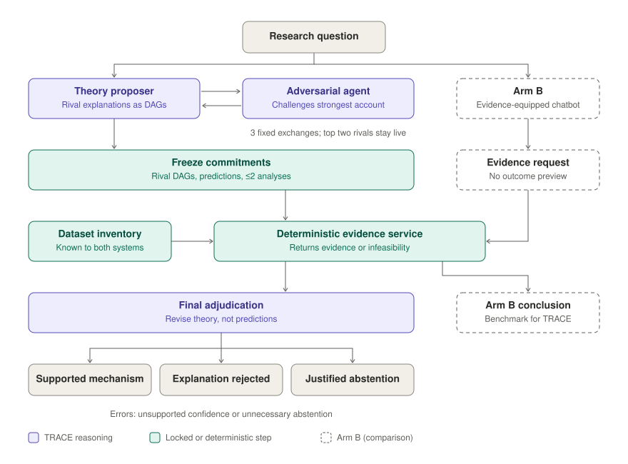

# TRACE: Theory Refinement through Adversarial Causal Evaluation

TRACE is a multi-agent AI workflow for developing organizational theory that can be audited. A proposer states rival explanations as causal graphs (DAGs). An adversary challenges them over three fixed rounds. Before seeing any results, TRACE freezes its two leading graphs, their contrasting predictions, and one irreversible request for evidence. A deterministic evidence service runs the request on a shared dataset inventory. Final adjudication may revise the theory but cannot rewrite the predictions.

The point is not a more convincing final theory. It is a record you can inspect: which rivals were considered, what was predicted in advance, and which prediction the evidence broke.

**Submitted Stage 1 artifact (Organization Science special issue, Nov 2026):** [`v1.0-stage1-submission`](https://github.com/swagatam11/TRACE-theory-refinement/releases/tag/v1.0-stage1-submission). Later commits add documentation only. The locked scientific records are unchanged.



## Start here

| If you have… | Read |
|---|---|
| 10 minutes | [**VIGNETTE.md**](VIGNETTE.md): one case walked through step by step, every claim linked to its locked record |
| 20 minutes | [REVIEWER_GUIDE.md](REVIEWER_GUIDE.md) and [TECHNICAL_APPENDIX.md](TECHNICAL_APPENDIX.md) |
| A terminal | [Reproduce offline](#reproduce-offline) below; no model calls, no API key |

## The three arms
All arms use OpenAI gpt-6.1-sol (Responses API, reasoning_effort=low)

- **A, question-only chatbot:** one plain response, with no background or data.
- **B, evidence-equipped chatbot:** gets the question, neutral background, and the public data inventory. It proposes at most two analyses in one batch, receives whichever are feasible, then finalizes. No DAG or adversarial instruction.
- **C, TRACE:** builds competing DAGs and completes **three** proposer–adversary exchanges *before seeing any test results*. It then freezes its predictions, submits one irreversible evidence batch of at most two analyses, and adjudicates.

B and C see the same data inventory. The evidence service is not a general statistical-programming agent: it interprets a bounded family of analyses and may refuse a request or fulfil it only partially. The demonstration documents this limitation.

## What the demonstration shows

On 30 October 2026, all three arms completed the synthetic `dev_03` case. TRACE's rival set changed across the three adversarial rounds. It froze a parallel-pathways account against strict legitimacy-gated usefulness, then requested two mediator-intervention studies. Relational wording raised simulated adoption interest when either proposed mediator was fixed at zero: +0.605 (95% CI [0.477, 0.733]) and +0.416 (95% CI [0.307, 0.524]). TRACE retained the multiple-route account provisionally and rejected strict serial gating as a complete explanation. It left the actual mediating routes unresolved. Arm B also proposed relevant mechanisms, requested the same interventions, and reached a similarly qualified conclusion.

**Limits.** The data are synthetic expressed interest, not observed adoption. Intervention assumptions were written into the generator, and transfer to field organizations is untested. The evidence service returned only part of each arm's requests. This is a process proof of concept, not evidence of superiority over B or of causal graph recovery.

## Reproduce offline

From the repository root, with Python 3.11+:

```bash
python -m pip install -r requirements.txt
export PYTHONPATH="code/synthetic_benchmark_v1/v6_one_shot:code/synthetic_benchmark_v1/preflight_rebuild:code/src"
python -m unittest discover -s code/synthetic_benchmark_v1/v6_one_shot -p 'test_v6*.py' -v
python replay_trace_dev03.py
python code/synthetic_benchmark_v1/v6_one_shot/live_v6.py inspect --case dev_03 --dataset data/synthetic_benchmark_v1/v6_synthetic_cases
python verify_locked_demo.py
```

On Windows PowerShell, use `$env:PYTHONPATH="code/synthetic_benchmark_v1/v6_one_shot;code/synthetic_benchmark_v1/preflight_rebuild;code/src"` instead of `export`. None of these commands call a model provider.

The public archive runs **7 offline unit tests**. The separately held full administrator suite passed **55 offline tests** before packaging. The Stage 1 artifact is an offline replay by design. A live harness that runs with a user-supplied API key is a Stage 2 deliverable.

## Repository contents

- `code/synthetic_benchmark_v1/v6_one_shot/`: the v6.3 three-round proposer–adversary workflow, the A and B comparators (`arms.py`), the evidence service (`evidence_desk.py`), schemas, and no-cost unit tests. `generator.py`, `validate_v6.py`, `admin_score.py`, and generator-dependent tests live **only in a separate administrator archive**, because they contain or access the hidden causal truth.
- `code/synthetic_benchmark_v1/preflight_rebuild/transport.py`: the frozen, bounded request mock and transport contract.
- `code/src/stigma_framing/`: support dependencies from the earlier audited project. The guarded live runner also needs historical budget ledgers, provider credentials, and project configuration, so **this archive is not a plug-and-play live API service**.
- `data/.../public/development/dev_03/`: the baseline and intervention synthetic datasets for the demonstration. `public/manifest.json` is the original full manifest; other cases are intentionally not shipped.
- `demo_locked/dev_03/`: the **unmodified scientific stage records**, sanitized model-input prompts, plaintext output fixtures, and a SHA-256 science-only lock. The full 48-file lock and provider envelopes are retained administrator-only.
- `SOURCE_MANIFEST.json`: SHA-256 file hashes and archive provenance.

## Naming and provenance

TRACE is the public name. Module names, stage labels, and hashes keep the internal prefix `EATD` (Evidence-Adversarial Theory Discovery) to preserve provenance. v6.3 is the frozen three-round, one-shot evidence implementation used here. No scientific code in the frozen implementation has been rewritten or renamed.
