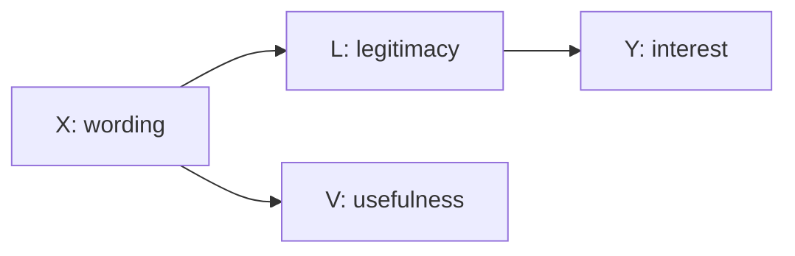
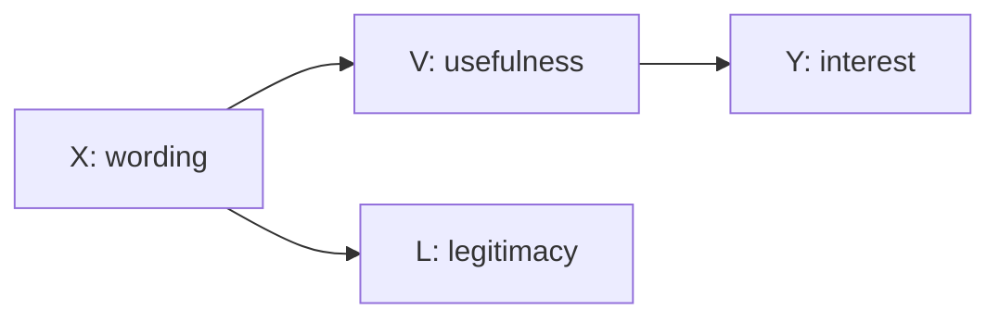
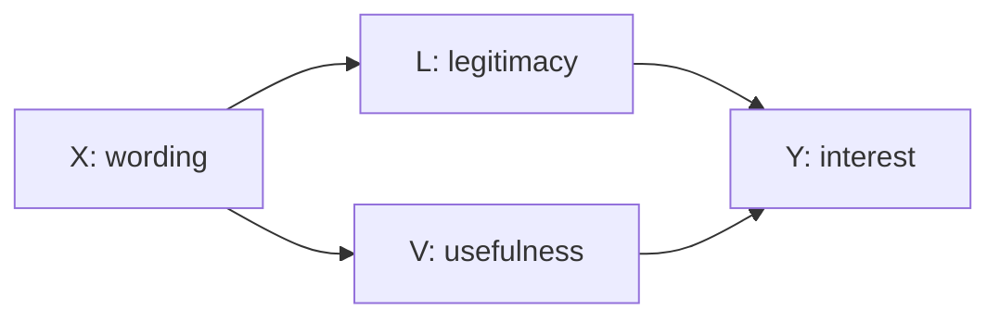
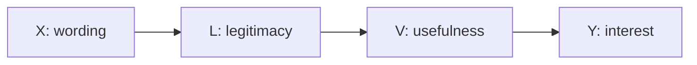

# TRACE in one case: a walkthrough of `dev_03`

This page follows one synthetic case from question to verdict. Every claim links to the locked record it comes from, so you can check each step yourself. Reading time is about ten minutes.

> **What this case is.** A purposively selected synthetic development case, run on 30 October 2026. It shows the process working. It is **not** a performance test, and it does not show TRACE beating a capable evidence-equipped chatbot.

## The question

Does a **relational** description of an assistive technology raise organizational adoption interest, compared with a **disability-attribute-bound** description of the same technology? A relational description frames the technology around interactions among people, tasks, and environments. ([case card](data/synthetic_benchmark_v1/v6_synthetic_cases/public/development/dev_03/card.json))

| Variable | Meaning |
|---|---|
| `X` | Relational (1) vs. disability-attribute-bound (0) description, randomized |
| `L` | Perceived legitimacy |
| `V` | Perceived usefulness |
| `Y` | Simulated expressed adoption interest |

The synthetic population is 3,600 organizational technology evaluators. Besides the baseline study, the dataset inventory lists separate evaluations in which `L` or `V` is fixed at zero. Both TRACE and Arm B see this inventory. Neither sees a menu of tests or any results.

## Step 1: Two restrictive starting theories

The proposer opens with two deliberately narrow rivals. ([`C_initial_priority.json`](demo_locked/dev_03/scientific/C/C_initial_priority.json))

Latent confounders are left out of the diagrams below for readability. The full graphs in the records include them.

**Rival 1: legitimacy only.** Framing changes usefulness, but only legitimacy drives interest.

**Rival 2: usefulness only.** Framing changes legitimacy, but only usefulness drives interest.

## Step 2: Three adversarial rounds, before any data

In each round the adversary must offer a counter-mechanism, state the disagreement, and name observations that would separate the accounts. The proposer then re-ranks, and only the top two rivals stay live.

| Round | Adversary's counter-mechanism | Proposer's top two afterwards | Retired |
|---|---|---|---|
| 1 ([challenge](demo_locked/dev_03/scientific/C/C_round_1_challenge.json), [ranking](demo_locked/dev_03/scientific/C/C_round_1_priority.json)) | **Serial:** legitimacy enables usefulness, `X → L → V → Y`. Both opening rivals assumed away the link between the mediators. | Serial; usefulness only | Legitimacy only |
| 2 ([challenge](demo_locked/dev_03/scientific/C/C_round_2_challenge.json), [ranking](demo_locked/dev_03/scientific/C/C_round_2_priority.json)) | **Parallel:** `L` and `V` each carry framing to interest independently. The serial ordering is unsupported. | Parallel; usefulness only | Serial |
| 3 ([challenge](demo_locked/dev_03/scientific/C/C_round_3_challenge.json), [ranking](demo_locked/dev_03/scientific/C/C_round_3_priority.json)) | **Legitimacy gates usefulness:** the serial account returns, because both live rivals assume framing reaches usefulness without legitimacy. | Parallel; legitimacy gates usefulness | Usefulness only |

The serial account enters in round 1, is demoted in round 2, and comes back in round 3 as the strongest challenge. This kind of advance and backtracking is what TRACE is built to make visible.

## Step 3: Freeze the rivals and predictions

Before any evidence arrives, TRACE locks the two final graphs and what each predicts. ([`C_frozen_evidence_decision.json`](demo_locked/dev_03/scientific/C/C_frozen_evidence_decision.json))

**Frozen rival 1: parallel pathways**

**Frozen rival 2: legitimacy gates usefulness (strict serial)**

| Account | Effect of `X` on `Y` with `L` fixed | Effect of `X` on `Y` with `V` fixed |
|---|---|---|
| Parallel pathways | Positive | Positive |
| Strict serial | Zero | Zero |
| Usefulness only (retired) | Positive | Zero |

Baseline correlations can't separate these accounts, because all three allow positive baseline effects. The intervention studies can.

## Step 4: One irreversible evidence request

TRACE asks for two analyses in a single batch: framing effects under the legitimacy-fixed study, and framing effects under the usefulness-fixed study, each against baseline. It explicitly rejects an instrumental-variable route because the exclusion assumptions are unestablished. ([`C_frozen_evidence_decision.json`](demo_locked/dev_03/scientific/C/C_frozen_evidence_decision.json))

The deterministic evidence service (`evidence_desk.py`) returns: ([`C_requested_evidence.json`](demo_locked/dev_03/scientific/C/C_requested_evidence.json))

| Intervention study | Effect of relational wording on `Y` | 95% CI | n |
|---|---:|---:|---:|
| `L` fixed at zero | +0.605 | [0.477, 0.733] | 3,600 |
| `V` fixed at zero | +0.416 | [0.307, 0.524] | 3,600 |

**Partial fulfilment.** The service returned these two contrasts but omitted the baseline effects and implementation checks TRACE also asked for. Both receipts are logged against TRACE's first request, so the request-to-receipt link isn't one-to-one. Stage 2 adds a one-to-one ledger.

## Step 5: Adjudication

TRACE may revise its theory, but it may not rewrite what it predicted. ([`C_final.json`](demo_locked/dev_03/scientific/C/C_final.json))

- **Parallel pathways: retained provisionally.** Both of its predictions survived. TRACE calls this compatibility, not confirmation: an omitted direct effect or another mediator could produce the same pattern.
- **Strict serial gating: rejected as a complete account.** It predicted zero under both interventions, and the evidence contradicts that, conditional on the interventions working as specified.
- **Usefulness only:** the positive effect with `V` fixed also challenges it.
- **Left explicitly unidentified:** the order between `L` and `V`, whether either measured score causes interest, the total effect and how much of it is mediated, moderators, and transfer to real adoption.

## Checking against the hidden truth

The generating equations were held administrator-only and examined only after the outputs were locked. They specify both pathways plus a small direct effect of wording on interest, with usefulness contributing more strongly.

TRACE's retained graph matches the two-pathway structure but omits the direct `X → Y` arrow. The intervention results can't tell the two apart, and TRACE's verdict says so.

## What the comparison arms did

- **Arm A** (question only, one call) gave a thoughtful conditional theory with no data and no testable commitment. ([`A_answer.json`](demo_locked/dev_03/scientific/A/A_answer.json))
- **Arm B** (evidence-equipped chatbot, two calls, no DAG or adversary) independently proposed both mechanisms. Its first request, for baseline effects, was refused as infeasible, which is a limitation of the evidence service. Its second request received the same two intervention contrasts, and it reached a similarly qualified conclusion. ([`B_requested_evidence.json`](demo_locked/dev_03/scientific/B/B_requested_evidence.json), [`B_final.json`](demo_locked/dev_03/scientific/B/B_final.json))

**The honest reading.** This case does not show that TRACE reasons better than B. It shows something B's transcript can't: a dated, inspectable record of which rivals were considered and dropped, what was predicted before the data arrived, and exactly which prediction the evidence broke.

## Cost

The whole case took 11 model calls, 28,390 tokens, and about $0.16 in API cost. TRACE's share was $0.11 across 8 calls.

## Verify it yourself

The commands in the README's [offline replay section](README.md#reproduce-offline) re-run the unit tests, replay all three arms from the locked records, and check every file against its SHA-256 lock. None of them call a model.
